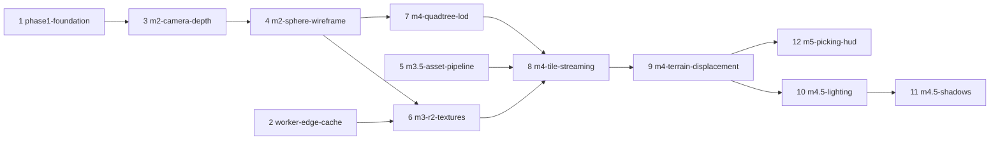

# Station Tycho: WebGPU Engine & 3D Lunar Map Plan

**Target:** `uat.kings.fyi` — Cloudflare Workers + R2 (`lunar-assets`)
**Stack:** Rust (`wasm32-unknown-unknown`), `wgpu` 30 (`webgpu` + `wgsl` features), `glam`, `web-sys`, TypeScript Worker, WGSL

---

## 1. System Overview

The Rust/WASM engine renders on the client GPU and streams multi-resolution lunar elevation and albedo tiles from R2 through the Worker.

```
[NASA LOLA / SLDEM2015 / LROC WAC source rasters]
        │  offline pipeline (GDAL reprojection → cube faces → tiling → quantization)
        ▼
[R2: lunar-assets  /v{N}/dem, /v{N}/albedo, /v{N}/meta]
        │  Worker `/assets/*` (src/index.ts) + Cache API
        ▼
[WASM engine (crate/src/lib.rs)]
   ├── Camera (f64) + camera-relative rendering
   ├── Quadtree LOD (SSE + frustum + horizon culling)
   ├── Tile fetcher (bounded concurrency, cancellation, LRU GPU cache)
   └── Render pipeline (WGSL displacement, Lommel-Seeliger shading, reversed-Z)
        ▼
[<canvas id="viewport">]
```

---

## 2. Phase 1 — Engine Foundation — DONE

### 2.1 Browser compatibility — DONE
- Upgraded `wgpu` 0.20 → 30. wgpu 0.20 always sent the removed `maxInterStageShaderComponents` limit, which Chrome rejects.
- Request only the limits the engine needs (start from `wgpu::Limits::default()`), not `adapter.limits()`, so behaviour is the same on every device.

### 2.2 Frame loop — DONE
- Current: JS `requestAnimationFrame` calls `Renderer.render(t)` (a `#[wasm_bindgen]` struct). Keep this model; it keeps lifetimes simple and the HUD in JS.
- A surface that is Lost or Outdated triggers a reconfigure. Timeout or Occluded skips the frame.

### 2.3 Resize & DPI — DONE
- Remove the fixed `width`/`height` attributes from the canvas.
- Watch the canvas with a `ResizeObserver` using `devicePixelContentBoxSize`. Call `Renderer.resize(w, h)`, which reconfigures the surface and rebuilds the depth texture.

### 2.4 Depth — DONE
- `Depth32Float`, **reversed-Z**: clear to `0.0`, compare with `Greater`, infinite-far perspective projection.

### 2.5 Fallback — DONE
- If `navigator.gpu` is missing or getting the adapter fails, show a clear unsupported-browser message (no WebGL fallback for now).

---

## 3. Phase 2 — Geometry: Spherified Cube Quadtree

### 3.1 Conventions
- **Units:** metres everywhere. `R_moon = 1_737_400 m` (IAU reference sphere).
- **Frame:** IAU Moon Mean-Earth (ME) body-fixed frame. +Z = north pole, +X = 0° lon / 0° lat.
- Define `latlon_to_cube(face, u, v)` and its inverse once in Rust and use them for streaming, picking, and the HUD.

### 3.2 Cube → sphere mapping
For $\mathbf{p} \in [-1,1]^3$ on a cube face:

$$
\mathbf{s} = \begin{bmatrix}
x\sqrt{1 - \tfrac{y^2}{2} - \tfrac{z^2}{2} + \tfrac{y^2 z^2}{3}} \\
y\sqrt{1 - \tfrac{z^2}{2} - \tfrac{x^2}{2} + \tfrac{z^2 x^2}{3}} \\
z\sqrt{1 - \tfrac{x^2}{2} - \tfrac{y^2}{2} + \tfrac{x^2 y^2}{3}}
\end{bmatrix}
$$

(More even than plain normalization, but not equal-area.)

### 3.3 Precision-safe vertex positions
Absolute positions (~1.7e6 m) in `f32` resolve only to about 0.2 m, which causes jitter. Therefore:
- **CPU (f64, `glam::DVec3`):** for each visible tile, compute its centre $\mathbf{T}$ and its 4 corner positions on the sphere.
- **GPU uniform (f32):** `tile_origin_rel = T − C_camera`, plus the corner offsets relative to `T`.
- **Vertex shader:** blend the corner offsets bilinearly (or use a small local cube-to-sphere evaluation relative to `T`), add `normal * h * exaggeration`, add `tile_origin_rel`, then multiply by the view-projection matrix.
- The view matrix contains **rotation only** (the camera sits at the origin).

**Current implementation:** the CPU computes every grid vertex in f64 and stores it as an f32 offset from the tile centre (12 bytes per vertex). The vertex shader adds `normal * h` (normal from the f32 tile centre plus offset, which is precise enough for a direction) and `tile_origin_rel`. There is no exaggeration control yet.

### 3.4 Shared grid mesh
- One static 65×65 vertex grid plus a **skirt** ring (pushed inward along the normal by a per-level depth) to hide cracks between LOD levels.
- Index buffer for triangles, and a separate line-list index buffer for wireframe. WebGPU has no polygon-mode line.
- While the wireframe is shown, the terrain is drawn with a slope-scaled depth bias (pushing the surface back) so lines on its edges stay visible at grazing angles. Normal rendering has no bias: on near-vertical skirts the bias can exceed the depth itself and leave pinholes.

**Current implementation** (`crate/src/geometry.rs`, `crate/src/shaders/terrain.wgsl`):
- 64×64 cells per tile, so vertex `(i, j)` sits exactly on DEM texel `(4i, 4j)`: heights are read with `textureLoad` (no filtering), and same-level neighbours share identical edge heights through the shared border texel.
- Shared by all tiles: triangle and line indices, and a second vertex buffer of `[u, v, skirt]`. Each tile owns only its 4,481 offsets (4,225 grid + 256 skirt), 53.8 KB.
- Skirt ring: copies of the edge vertices, lowered by a per-tile depth = drawn error of the tile + drawn error of its coarsest edge neighbour (found per frame, including across cube faces). Two meshes differ from the true terrain by at most their drawn errors, so this closes any step between neighbours.
- The terrain and tile-wireframe entry points share one `displaced()` function, so the wireframe follows the terrain exactly.
- DEM scale and offset come from the manifest.
- Debug keys: W wireframe, H heights, C magenta background (any magenta inside the terrain is a crack), K skirts off.

### 3.5 LOD selection
- Screen-space error: $\rho = \dfrac{\epsilon_{\text{level}} \cdot H_{\text{px}}}{2\,d\,\tan(\text{fov}/2)}$. Split when $\rho > \tau$ (for example 2 px).
- $\epsilon_{\text{level}}$ = geometric error per level, taken from the manifest (or halved per level).
- Cull with the view frustum and the **horizon** (the occluding sphere test).
- Keep a parent visible until all 4 children have loaded, so the terrain never shows holes.

**Current implementation** (`crate/src/lod.rs`):
- Tiles are drawn as 64×64-cell grids (§3.4), so a level-L tile has the vertex spacing of level L−2's full grid: its drawn error is `geometricError[L−2]`, doubling per level above level 0.
- Bounds: per-tile angular radius from its corners and edge midpoints, widened by the maximum terrain height (10.8 km) for both the frustum sphere and the horizon test.
- $\epsilon$ = max(drawn terrain error, from the manifest's `geometricError`; sag of the tile's flat grid cells). Split threshold 2 px, deepest level = the manifest's last level (7 in v2).
- Priority refinement: always split the tile with the largest screen-space error; stop at the first split that would exceed the 1,024-tile budget, so a tight budget goes to the nearest terrain.
- Readiness = the tile's DEM and albedo are resident on the GPU (§6). Pending children are returned as requests (most urgent first). A tile with a visible child that is unavailable (not in the manifest, 404, or failed for good) never splits, so refinement stops where the data does: level 3 away from Tycho, level 7 around it.

---

## 4. Phase 3 — Asset Pipeline & Edge Delivery

### 4.1 Source datasets
| Use | Dataset | Coverage / resolution |
|---|---|---|
| DEM (mid-latitudes) | SLDEM2015 (LOLA + Kaguya TC) | ±60° lat, ~59 m/px |
| DEM (poles) | LOLA polar stereographic DEMs | >60° lat, 5–20 m/px |
| DEM (Tycho detail) | LROC NAC DTMs | local, ~2–5 m/px |
| Albedo | LROC WAC **Hapke-normalized** reflectance mosaic | global, ~100 m/px |

Do **not** use the WAC *Morphology* mosaic for albedo: its shading is baked in and would be lit twice.

### 4.2 Offline pipeline
1. Reproject each source to the 6 cube faces (GDAL warp with a custom cube-face projection, or a Python/Rust resampler).
2. Blend the DEM sources with feathered seams (SLDEM ↔ polar at about 60°).
3. Tile each face into a quadtree. Tiles are **257×257** (one shared border pixel) so neighbouring tiles line up exactly.
4. Quantize the DEM to `u16` with a global `scale` and `offset` (range about −9.2 km to +10.8 km, 0.5 m/LSB).
5. Write `manifest.json`: per-level tile availability, min/max height per tile, geometric error per level, quantization parameters, dataset version.

**Current implementation** (`tools/pipeline/`, Node, no dependencies; raw data in git-ignored `data/`):
- `npm run assets:download` fetches ~3.1 GB into `data/raw`: LOLA `LDEM_64` (global, ~474 m/px), the SLDEM2015 512 px/deg tile covering Tycho (60°S–30°S, 315°E–360°E) and the 8 WAC Hapke 643 nm tiles (±70°, ~400 m/px).
- `npm run assets:build` resamples them (bilinear, straight from simple-cylindrical) into `data/tiles/v2`: levels 0–3 everywhere from `LDEM_64`, levels 4–7 only around Tycho from SLDEM2015, feathered into `LDEM_64` over 0.5°. Albedo poleward of 70° is a flat fill until polar mosaics are added.
- `npm run assets:validate` checks the manifest, file sizes, complete sibling sets, per-tile min/max and identical heights on every shared edge (including across faces).
- `npm run assets:upload:local` / `assets:upload:remote` bulk-upload tiles, then the manifest.
- Not yet: LOLA polar DEMs, LROC NAC DTMs, polar albedo.

### 4.3 R2 layout (versioned, immutable)
```text
lunar-assets/
└── v{N}/
    ├── meta/manifest.json
    ├── dem/{face}/{level}/{x}/{y}.bin       # u16 LE, 257×257
    └── albedo/{face}/{level}/{x}/{y}.rgba   # RGBA8 (KTX2 later)
```
`face ∈ {px, nx, py, ny, pz, nz}`. Never overwrite a tile; publish a new `vN` instead.

Pixel layout: row-major, pixel `(x, y)` of a level-0 tile sits at face coordinates `u = -1 + 2x/256`, `v = -1 + 2y/256` (face axes as in `Face::axes` in `crate/src/geometry.rs`). At level `L`, tile `(tx, ty)` covers `u ∈ [-1 + 2tx/2^L, -1 + 2(tx+1)/2^L]`, likewise for `v`.

Versions: `v1` holds the synthetic M3 test tiles from `npm run tiles:test` (`tiles:test:local` uploads them locally). `v2` is the first real dataset from the pipeline and is what the engine reads.

### 4.4 Worker (`src/index.ts`)
- Already done: `Cache-Control: public, max-age=31536000, immutable`, Cache API (`caches.default`), `ETag` / `If-None-Match`, `Range`, and same-origin only (no CORS header).
- Note: the Cache API is per data centre, so the first request in each location is a miss.

---

## 5. Phase 4 — Shading & Camera

### 5.1 Textures (WebGPU-core safe)
| Data | Format | Sampling |
|---|---|---|
| DEM | `R16Uint` (or `R32Float`) | `textureLoad` + manual bilinear in the vertex shader |
| Albedo | `Rgba8UnormSrgb` | filtered sampler |
| Albedo (later) | KTX2/BasisU → BC7 / ASTC / ETC2 by adapter features | needs a WASM transcoder |

### 5.2 Bind groups (`crate/src/shaders/lunar_terrain.wgsl`)
- **Group 0 (per frame):** `view_proj` (rotation-only view), `sun_dir: vec4<f32>` (padded), `exaggeration`, `debug_flags`.
- **Group 1 (per tile):** `tile_origin_rel: vec4`, corner offsets, `uv_scale_offset: vec4`, DEM texture, albedo texture.
- Later: move to texture arrays or an atlas to cut bind-group churn.

### 5.3 Lighting
- Start with **Lommel-Seeliger**, blended with Lambert (lunar-Lambert / McEwen). Add the Hapke opposition surge later.
- No atmosphere: black sky, hard terminator.
- **Shadows** (crater rims, central peaks) need a separate technique: per-tile horizon maps (precomputed offline) or a cascaded shadow map. Vertex displacement alone only gives shading, not cast shadows.

**Current implementation** (`crate/src/shaders/terrain.wgsl`, `crate/src/lighting.rs`):
- Per-pixel terrain normals from the full-resolution DEM: central-difference slopes at the four nearest texels, blended bilinearly, scaled by each tile's metres per texel and applied along the face's u/v axes projected onto the local horizontal. Shading therefore has 4× the detail of the 64×64 mesh.
- McEwen's lunar-Lambert function, $2L\mu_0/(\mu_0+\mu) + (1-L)\mu_0$, with $L(\alpha) = 1 - 0.019\alpha + 2.42{\cdot}10^{-4}\alpha^2 - 1.46{\cdot}10^{-6}\alpha^3$ (α = phase in degrees). The result is divided by its value at the albedo mosaic's reference geometry (incidence 30°, emission 0°, phase 30°), so a texel shows as stored under standard lighting.
- No ambient light. A pixel is black if its terrain normal faces away from the sun, or if the sun is more than 3.5° below the reference horizon (the most a 10.8 km peak can still see).
- The sun's sub-solar latitude is fixed at 0 (it stays within ±1.6°). The default sub-solar longitude of 80°W puts the sun 15° above Tycho, with the terminator about 470 km to its east. `[`/`]` move it 5° (1° with Shift); L shows the unlit albedo.
- The canvas's preferred format is not sRGB (`bgra8unorm`), so the renderer draws through an sRGB view of it. Before this, linear values were written straight to the canvas and the albedo looked darker than its data.

### 5.4 Camera & input
- Orbit camera stored in f64 (target, distance, azimuth, elevation). Mouse and touch drag, wheel zoom (scaled logarithmically with altitude).
- Near plane scales with altitude; far plane is infinite (reversed-Z).
- **Current implementation:** the orbit target sits on the drawn terrain. Its height eases towards the terrain height under it (20 % per frame), so a tile refining to slightly different heights does not make the view jump. If the camera would be less than 1 m above the drawn terrain, it tilts up around the target until it clears; it never lowers the tilt again. Altitude in the HUD and for the near plane is height above the terrain under the camera.

---

## 6. Runtime Systems
- **Tile cache:** LRU with a GPU memory budget. Evict tiles that haven't been visible for N frames.
- **Fetching:** at most 6–8 requests in flight, priority = SSE × visibility, cancel requests that are no longer needed (`AbortController`).
- **Errors:** a 404 or a failed decode marks the tile unavailable and keeps the parent visible.
- **Picking:** keep downsampled height data on the CPU per loaded tile. Cast a ray from the camera against the sphere plus heights, convert the hit to lat/lon with `cube_to_latlon`.
  - Current implementation (`crate/src/terrain.rs`): each GPU slot keeps the 65×65 `u16` heights its grid renders (8.4 KB, about 5 MB for all 596 slots). Heights are looked up in the drawn tiles only and interpolated over the mesh's own triangles, so picks land on exactly what is on screen.
  - The ray starts where it enters the sphere of maximum terrain height (10.8 km). It steps by half its current height above the ground (no jumping through slopes up to about 63°), then bisects the crossing.
  - A left click without dragging (under 4 px) picks. The HUD's second line shows the orbit target and the last picked point (latitude, longitude, height).

**Current implementation** (`crate/src/manifest.rs`, `crate/src/streaming.rs`, `crate/src/renderer.rs`):
- The page fetches `v2/meta/manifest.json` first; it supplies tile availability and per-level geometric error. Nothing is drawn until it loads.
- At most 4 tiles (8 requests: albedo + DEM) in flight, started in the selector's priority order. Each frame, loads the selection no longer requests are aborted; late results of aborted or superseded requests are ignored.
- 404 or wrong size: unavailable for the session. Network/server error: retry after 1 s, then 2 s, then unavailable.
- GPU budget 256 MiB ÷ 450,066 bytes per tile (257² RGBA8 albedo + 257² `u16` DEM + 4,481 12-byte vertex offsets) = 596 slots. Each slot owns its textures, vertex buffer and bind group, and is reused after eviction, so GPU memory never exceeds the budget.
- A load starts only if a slot will be free when it arrives (unused, or evictable). Least recently used tiles are evicted on demand; face roots and this frame's visible tiles and their ancestors never are. Data that arrives after its room has gone is dropped and re-requested later.
- Each tile is textured from its own albedo and DEM; uv addresses the tile's texture, so `uv_scale_offset` is not needed while only ready tiles are drawn.

---

## 7. Roadmap

| Milestone | Deliverable | Verification |
|---|---|---|
| **M1: Heartbeat** ✅ | wgpu 30, animated test pipeline, FPS readout | Rotating triangle at refresh rate; HUD shows `WebGPU Engine Online` |
| **M2: 3D foundation** ✅ | f64 orbit camera, camera-relative rendering, procedural sphere (6 faces, line-list wireframe). Reversed-Z depth and resize/DPI were delivered in Phase 1 | 60 FPS sphere, mouse orbit/zoom, no jitter at 1 m altitude |
| **M3: R2 textures** ✅ | Fetch a raw RGBA8 + `u16` DEM test tile from `/assets/v1/...`, upload with `write_texture` | Sphere textured from R2; second load served from the edge cache (`cf-cache-status: HIT`) |
| **M3.5: Asset pipeline** ✅ | Cube-face reprojection, 257² tiling, quantization, manifest, upload script | Manifest validates; neighbouring tiles share identical edge heights |
| **M4: Quadtree terrain** ✅ | SSE + horizon culling, skirts, tile-relative displacement, LRU cache, prioritized fetching | Tycho rim and central peak visible; no cracks or holes while zooming |
| **M4.5: Lighting** | Lommel-Seeliger shading, sun controls, horizon-map shadows | Terminator crossing Tycho shows correct relief shadows |
| **M5: HUD & telemetry** | CPU-side picking, lat/lon/altitude readout, streaming stats (in-flight, cached, GPU MB) | Clicking Tycho's centre reads about 43.3°S, 11.2°W |

---

## 8. Open Decisions
- KTX2 transcoder choice (`basis_universal` via C++ → WASM vs. a pure-Rust alternative) and when to adopt it.
- Whether to support adapters without WebGPU at all (WebGL2 backend in wgpu) or show an unsupported message only.
- Hosting R2 tiles on a custom domain instead of serving them through the Worker.

---

## 9. Development Plan & Rules

### 9.1 Branching model
- `main` is the release branch. `dev` is the integration branch.
- Every piece of work is a short-lived `feature/*` branch cut from `dev` and merged back into `dev` through a PR.
- Merge `dev` into `main` (fast-forward) only when `dev` builds and the last milestone's verification has passed.
- Documentation-only changes (such as this file) may be committed straight to `dev`.

### 9.2 Branches and merge points
| # | Branch | Scope | Depends on | Merge into `dev` when |
|---|---|---|---|---|
| 1 | `feature/phase1-foundation` ✅ | Default device limits, resize/DPI, `Depth32Float` reversed-Z, unsupported-browser message, commit `Cargo.lock` (remove from `.gitignore`), move shader to `shaders/test.wgsl` | none | Resize keeps the triangle sharp at any window size, `npm run build` passes, and a clear message shows when WebGPU is missing |
| 2 | `feature/worker-edge-cache` ✅ | `src/index.ts`: Cache API, `ETag` / `If-None-Match`, `Range`, tighter CORS | none (parallel) | Repeat request returns `cf-cache-status: HIT`, matching `ETag` returns 304, `npm run typecheck` passes. Merge before M3 is verified |
| 3 | `feature/m2-camera-depth` ✅ | Add `glam`, f64 orbit camera, camera-relative rendering, mouse/touch controls, projection | 1 | A test object stays steady (no jitter) while orbiting and zooming close |
| 4 | `feature/m2-sphere-wireframe` ✅ | `latlon_to_cube` and inverse, cube-to-sphere mapping, 6-face sphere drawn as lines | 3 | 60 FPS sphere, orbit works, round-trip lat/lon test passes |
| 5 | `feature/m3.5-asset-pipeline` ✅ | Offline tooling (e.g. `tools/`): cube-face reprojection, 257×257 tiling, `u16` quantization, `manifest.json`, upload script | none (parallel) | Manifest validates and neighbouring tiles have identical edge heights |
| 6 | `feature/m3-r2-textures` ✅ | Fetch test RGBA8 + `u16` DEM tiles from `/assets/v1/...`, upload to GPU textures, texture the sphere | 2, 4 | Sphere shows the R2 texture and the second load comes from the edge cache |
| 7 | `feature/m4-quadtree-lod` ✅ | Quadtree, screen-space-error selection, frustum and horizon culling, parent-until-children-ready rule | 4 | Tiles split and merge smoothly while zooming, no holes, using placeholder heights |
| 8 | `feature/m4-tile-streaming` ✅ | Fetcher with limited concurrency, `AbortController` cancellation, LRU cache with GPU memory budget | 5, 6, 7 | Panning/zooming keeps requests within the limit, cancelled tiles stop loading, memory stays under budget |
| 9 | `feature/m4-terrain-displacement` ✅ | Tile-relative displacement from DEM heights, edge skirts, overlap-aware tile edges; the wireframe shader shares the same displacement so it stays usable for crack checks | 8 | Tycho's rim and central peak visible, no cracks between LOD levels |
| 10 | `feature/m4.5-lighting` ✅ | Lommel-Seeliger shading with Lambert blend, sun controls, albedo texturing | 9 | Terminator and lit terrain look correct, sun direction responds to controls |
| 11 | `feature/m4.5-shadows` | Horizon maps (offline pipeline addition plus shader) or a shadow map | 10, 5 | Terminator crossing Tycho shows relief shadows |
| 12 | `feature/m5-picking-hud` | CPU-side height data, ray picking, lat/lon/altitude readout, streaming stats; keep the orbit target and camera above the terrain (the target is on the reference sphere, so over high ground a low camera can end up underground) | 9 | Clicking Tycho's centre reads about 43.3°S, 11.2°W |



- Branches 2 and 5 touch different files from the engine (`src/index.ts` and `tools/`), so they can run at any time without conflicts.
- Branches 11 and 12 can run in parallel once branches 10 and 9 are in.

### 9.3 Rules
- **Build gate:** `npm run build` and `npm run typecheck` must pass before merging into `dev`. `npm run test:engine` runs the camera and geometry tests on the host.
- **Tags:** tag `dev` after each engine milestone: `m2-done` (after 4), `m3-done` (after 6), `m4-done` (after 9), `m4.5-done` (after 11), `m5-done` (after 12).
- **Tile format first:** test tiles used in branch 6 must already follow the 257×257, `u16` layout and `/v1/` key scheme in §4.2–4.3, so branch 6 doesn't change when branch 5 lands.
- **Rebase:** rebase long-running branches (7 to 9) onto `dev` regularly.
- **Dependencies:** keep `Cargo.lock` committed so wgpu and other crate versions are reproducible.
- **Model choice:** routine edits suit a faster model. Use the strongest reasoning model for branches 3, 4, 5, 7 and 9 (precision maths, reversed-Z, SSE and horizon culling, reprojection), where bugs only show at certain altitudes.